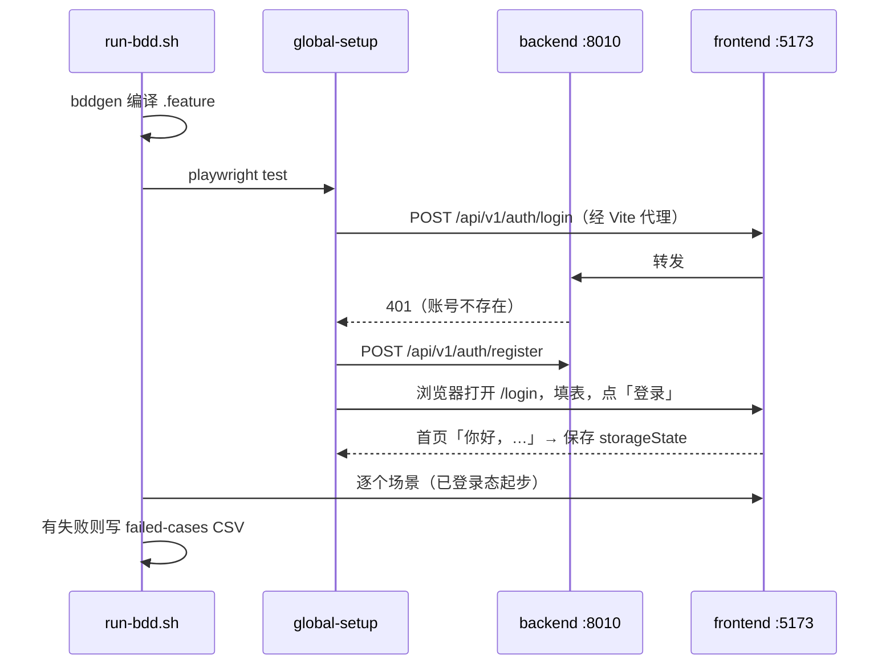

# 技术设计：引入 voice-agent 交付链与 AutoTest（试用期）

> 由 `/feature-design` 在**无人值守模式**下产出。三个关卡都是「自动确认，待你审」，见下表和文末 Decision Log。

| 关卡 | 结论 | 依据 |
|---|---|---|
| Step 1 影响面 | 见 §5 | 分支上 5 个 commit 的真实 diff |
| Step 2 分级 | **T6 外部依赖变化**；无次级 | 新增开发期依赖（Playwright、playwright-bdd、tsx），不改产品代码 |
| Step 3 设计 | 见 §2–§8 | 用户在会话里定的 4 个决定，加适配取舍 |

Feature: 引入 voice-agent 的交付链（设计 → 清单 → 验证指导 → 审查）和 AutoTest E2E 框架，作为 vj 链的试用期并行方案
Type: T6 — External Dependency Change
Date: 2026-11-09
Status: Confirmed（自动确认，待审）
Branch: `feat/import-voice-agent-delivery`（基于 `master` @ `12aded5`）

---

## 1. 背景与动机

- 用户判断 voice-agent 的这套流程很重要，要求引入 vibejet：核心尽量保持原生，只做必要适配。
- vibejet 现状：有 vj 链（Patch / Story / Epic → vj-epic-plan → vj-work）和 story-verify-fix、vj-test 等验证 skill；没有机器检查的验证指导，没有端到端测试框架（前端只有 vitest 单测），也没有「测试必须能在旧版本上失败」这条区分度纪律。
- 用户已拍板（2026-11-09）：与 vj 链**试用期并存**；**原生关卡 + 无人值守模式**；**skill 与规范保持英文原文，产出只写中文**；**连测试框架一起搬**。

## 2. 方案概述

先原样复制（源 voice-agent `1254c8bbe0`，单独一个 commit），再按「路径与项目事实 → Release-Check → 测试框架 → CI」逐层适配，每层一个 commit，这样 diff 就是「改了原版哪里」的清单。引入的 skill 一律标 `status: experimental`：默认仍走 vj 链，显式调用才走新链。E2E 先覆盖 vibejet 现有的两个前端功能（登录、首页），用真实运行证明框架可用。

## 3. 架构：前后

**Before**

```
需求 → vj 路由 → Patch | Story | Epic → vj-epic-plan → vj-work → review / story-verify-fix / vj-test
验证：pytest + vitest + 浏览器手工或 AI 走查
```

**After（并存，默认不变）**

```
默认：同上
显式调用：
  /feature-design | /bug-fix-design → 写代码 → /feature-checklist | /bug-fix-checklist → 验证指导 → /delivery-code-review
     产出 docs/work/delivery/YYYY-MM/DD-type-slug/{design,checklist,review}.md + AutoTest/Release-Check/YYYY-MM/
  AutoTest/：Playwright + playwright-bdd ← /prd-to-bdd 生成、/run-test 执行、/test-self-heal 修测试侧问题
CI：backend job（不变）+ autotest-checks（lint、typecheck、bddgen；不跑 E2E）
```

| 组件 | 职责 |
|---|---|
| `docs/reference/guides/delivery/` | 流程规范、T1–T6 分级、设计规范、清单模板（英文原文） |
| 4 个设计 / 清单 skill | 根因（bug）或影响面 → 分级 → 设计 → 清单（AUTO 自动执行）→ 起草验证指导 |
| `writing-release-check` + `check_refs.py` | 按审查清单写验证指导；校验每个 `文件:行` 真实存在 |
| `AutoTest/core/release-check/` | 验证指导 lint（15 条规则）+ 只读数据库工具 |
| `AutoTest/` 测试框架 | 用例 CSV → 英文剧本 → 页面对象 + 步骤；全局前置负责测试账号和登录态 |



## 4. 改动

> **一句话**：原样复制 + 分层适配 + 真实运行验证。

**做了什么**（按 commit）：

- `2e0849a` ci: run AutoTest checks (Release-Check lint, BDD lint, typecheck, step matching)
- `fbee86b` chore(autotest): adapt the AutoTest E2E framework and test skills to vibejet
- `909cd82` chore(release-check): adapt Release-Check lint, standard and shared rules to vibejet
- `e4c7c25` chore(workflow): adapt delivery skills and standards to vibejet
- `67fe5b6` chore(workflow): import voice-agent delivery workflow and AutoTest verbatim

**不改什么**：产品代码（`backend/`、`frontend/`）；vj 链 skill；根目录 `AGENTS.md` 和 `docs/reference/guides/ai-workflow.md`（主工作区里这两个文件有你未提交的改动，在分支上改会冲突，接线文本见 §8）。

| 维度 | 改动 | 说明 |
|---|---|---|
| DB changes | N/A — 不改 schema | E2E 在本地库里注册测试账号 `e2e-fixture-user-a` |
| Environment variables | AutoTest 专用：`E2E_ENV` / `E2E_BASE_URL` / `E2E_USERNAME` / `E2E_PASSWORD` / `HEADLESS` / `WORKERS` | 产品服务的环境变量不变 |
| Business logic flow | 见 §3 时序图 | 产品逻辑不变 |
| API changes | N/A | 只调用现有接口 |
| Async / background tasks | N/A | — |
| Configuration | `AutoTest/config/environments.json`（gitignored）；CI 新 job `autotest-checks` | — |
| External service calls | N/A（运行时）；开发期依赖见下表 | — |

**T6 依赖变化分析**

| 依赖 | 版本 | 来源 | 破坏性 |
|---|---|---|---|
| `@playwright/test` | 1.59.1 | 与源仓库一致 | 新增，无旧版本 |
| `playwright-bdd` | ^8.5.0 | 与源仓库一致（最新 9.2.1，未升级，保持原生） | 新增 |
| `tsx` | ^4.19.0 | 新增；源仓库用 `npx` 临时下载，这里锁进 lockfile，保证可复现 | 新增 |
| `typescript` / `yaml` / `@types/node` | ^5.7 / 2.5.1 / ^22 | 与源仓库一致 | 新增 |

所有依赖只在独立的 `AutoTest/package.json` 里，不进入 `backend/pyproject.toml` 或 `frontend/package.json`。

## 5. 影响面

- 分支总改动：91 files changed, 9980 insertions(+)
- 产品代码：0 files changed
- vj 链 skill：0 个文件改动
- 新增 skill 9 个（仓库现有 51 个 skill 目录），新增 agent 1 个（`heal-verifier`）
- 关键路径：无（不改产品代码）

## 6. 副作用与风险

1. **两条交付链并存，AI 可能选错**：新 skill 都标了 `experimental`，只在显式调用时使用；根目录 AGENTS.md 的接线等你合并自己的改动后再加（§8）。
2. **skill 数量上升**（+9 个），和之前「减法方案」的方向相反：试用期结束后按证据删掉输的一方。
3. **原版 lint-bdd 的缺陷已修**（嵌套目录被跳过），因此与源仓库不再逐字一致；以后从 voice-agent 同步更新时要保留这处修复。
4. **本地跑 E2E 有三个 vibejet 自身的坑**（Python 3.11、arm64 缺 greenlet、翻译文件未编译），已写进 `AutoTest/AGENTS.md`「前置」，本分支没有修。
5. **CI 多一个 job**，约 1 分钟。
6. **测试账号留在本地库里**（用户没有删除接口），这是 `fixtures.md` 里登记的常驻夹具。

可回滚：YES。删掉分支，或 revert 这 5 个 commit。

## 7. 类比排查

模式：**从源仓库搬来的东西，暗含源仓库环境的假设。**

| 位置 | 查了吗 | 结果 | 处理 |
|---|---|---|---|
| lint-bdd 只看 `modules/<m>/features` | 是 | 源仓库的缺陷：嵌套功能目录被跳过 | 本次修复（递归查找） |
| 用例 CSV 中英两份 | 是 | 依赖源仓库的双语政策 | 改成单份中文 |
| 验证指导按发版分支归档 | 是 | vibejet 没有发版分支 | 改成按月份 |
| P0 规则里的「第二个 QA 组织」 | 是 | vibejet 是账号隔离，不是组织隔离 | 改成第二个测试账号 |
| API 客户端用租户 cookie | 是 | vibejet 只认 Bearer | 改成从登录态取 token |
| 全局前置走 SSO | 是 | vibejet 是用户名 + 密码登录 | 改成真实 /login 页 |
| run-test 的 agent-browser 策略 | 是 | 本机没装，源仓库也没在用 | 去掉 |
| 功能树覆盖率 | 是 | 依赖 PM 维护的功能目录，vibejet 没有 | 不搬 |
| 本地环境三处坑 | 是 | vibejet 自身问题 | 记录为后续任务（§6.4） |

后续任务：本地环境三处坑；AGENTS.md 接线（§8）；试用期结束后的裁决。

## 8. 接线待办（交给你）

等你提交自己对 `AGENTS.md` 的改动后，在「AI Workflow Entry Points」之后加一节：

```markdown
### 试用期：voice-agent 交付链（experimental）

与 vj 链并存的第二条交付链，搬自 voice-agent 并适配本仓库。**默认仍走 vj 链**，显式调用以下 skill 时才走这条：

- 设计 → 写代码 → 检查清单（最后一步起草验证指导）→ 审查：`/feature-design` 或 `/bug-fix-design` → `/feature-checklist` 或 `/bug-fix-checklist` → `/delivery-code-review`
- 产出：`docs/work/delivery/YYYY-MM/DD-{feature|bugfix}-slug/` + `AutoTest/Release-Check/YYYY-MM/`；规范在 `docs/reference/guides/delivery/`
- E2E：`AutoTest/`（入口 `AutoTest/AGENTS.md`）；生成用例 `/prd-to-bdd`，执行 `/run-test`，修测试 `/test-self-heal`
- 裁决：跑 2–3 个真实改动后按证据二选一，删掉输的一方
```

并在 Project Structure 里加一行 `AutoTest/  # E2E 测试与 Release-Check 验证指导（试用期）`。

---

## Decision Log

### 自动确认的关卡

- Step 1 影响面、Step 2 分级（T6）、Step 3 设计：`Gate: auto-confirmed — pending user review`。依据见文首表格。

### 与 vj 链的关系 — Decision Discussion

**Decision point (option comparison)**：替换重叠部分 / 试用期并存 / 嫁接。
**Additional context**：用户要求核心保持原生。
**Rationale**：用户选择试用期并存，用 2–3 个真实改动的证据来裁决，而不是先验判断。
**Decision**：并存；新 skill 标 `experimental`。

### 确认关卡 — Decision Discussion

**Decision point**：完全原生（每步必须点 Confirm）/ 原生 + 无人值守模式 / 只留最后一关。
**Rationale**：用户常用「全权交给你」的异步工作方式，完全原生会卡在第一个关卡。
**Decision**：原生 + 无人值守模式。无人值守时关卡结论写进 Decision Log，标「待你审」。

### 文档语言 — Decision Discussion

**Decision point**：中英两份 / skill 英文、产出中文 / 全部中文。
**Rationale**：skill 保持原文，方便以后同步 voice-agent 的更新；产出只写一份，避免维护两份。
**Decision**：skill 与规范英文原文，产出只写中文（用例 CSV 也只保留中文一份）。

### 范围 — Decision Discussion

**Decision point**：先搬交付链 / 连测试框架一起。
**Decision**：连测试框架一起（用户选择）。

### 适配取舍（本设计自定，待你审）

- **验证指导按月份归档**（`YYYY-MM`），和 `docs/work/delivery/` 一致。拒绝方案：按目标分支（vibejet 只有 master / main，没有区分度）。
- **`code-review` 改名为 `delivery-code-review`**：Claude Code 自带同名 skill，会冲突。
- **lint-bdd 改为递归查找目录**：原版在嵌套布局下会空跑。
- **不改根目录 AGENTS.md / ai-workflow.md**：避免与你未提交的改动冲突（§8）。
